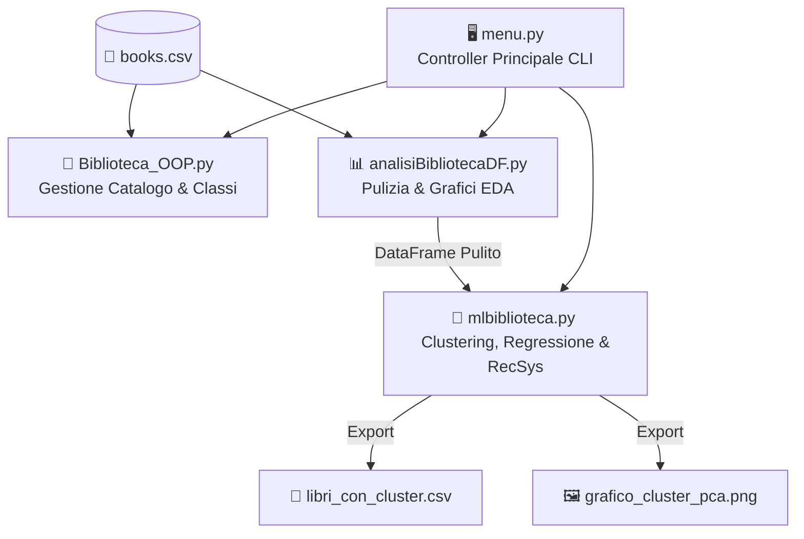
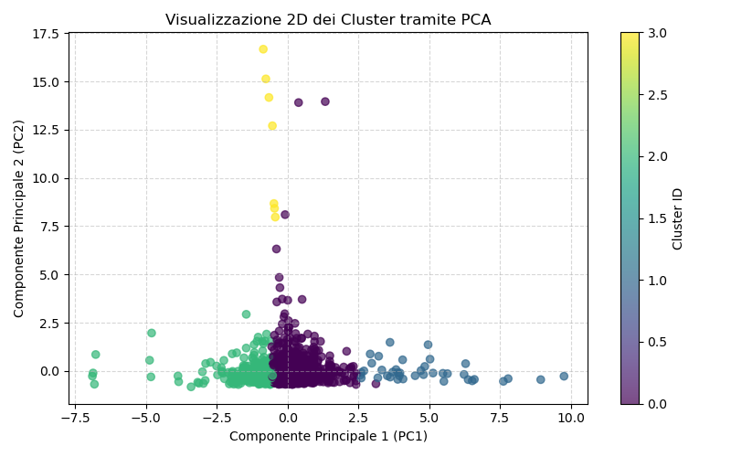

<div align="center">

# 📚 Intelligent Library System
### Sistema Integrato di Gestione, Analisi Dati e Machine Learning per Biblioteche


## 👥 Il Team — I Bibliotecari

| Membro del Team | Ruolo nel Progetto | Contatto |
| :--- | :--- | :---: |
| **Alessandro Moceri** | Programmazione ad Oggetti (OOP) | [](https://www.linkedin.com/in/LINK-ALESSANDRO/) |
| **Alessia Mori** | Analisi Dati & Visualizzazione (EDA) | [](https://www.linkedin.com/in/LINK-ALESSIA/) |
| **Davide Fioretti** | Machine Learning & Sistemi Predittivi | [](https://www.linkedin.com/in/LINK-DAVIDE/) |
| **Francesco Grasso** | Architettura, Integrazione & Menu CLI | [](https://www.linkedin.com/in/francesco-grasso-36027437b/) |

</div>

---

## 📑 Indice
1. [Descrizione e Obiettivi del Progetto](#-descrizione-e-obiettivi-del-progetto)
2. [Architettura del Sistema](#-architettura-del-sistema)
3. [Moduli e Funzionalità](#-moduli-e-funzionalità)
   - [Modulo 1: Programmazione ad Oggetti (OOP)](#1-modulo-oop-biblioteca_ooppy)
   - [Modulo 2: Analisi Esplorativa dei Dati (EDA)](#2-modulo-analisi-dati-analisibibliotecadfpy)
   - [Modulo 3: Machine Learning & Sistemi Predittivi](#3-modulo-machine-learning-mlbibliotecapy)
4. [Risultati Sperimentali e Grafici](#-risultati-sperimentali-e-grafici)
5. [Installazione ed Esecuzione](#-installazione-ed-esecuzione)
6. [Struttura della Repository](#-struttura-della-repository)

---

## 🎯 Descrizione e Obiettivi del Progetto

**Intelligent Library System** è un'applicazione modulare sviluppata in Python progettata per trasformare la gestione tradizionale di una biblioteca in un ecosistema *data-driven*. 

Il software copre l'intero ciclo di vita del dato:
* **Gestione Operativa:** Modellazione ad oggetti del catalogo, dei prestiti, delle restituzioni e della collocazione fisica sugli scaffali.
* **Business Intelligence & EDA:** Pulizia del dataset (`books.csv`) e visualizzazione statistica tramite grafici statici e interattivi.
* **Intelligenza Artificiale:** Segmentazione automatica dei volumi, previsione dei prestiti futuri per ottimizzare gli acquisti e motore di raccomandazione per gli utenti.

---

## 🏗️ Architettura del Sistema

Il software segue un'architettura modulare coordinata da un'interfaccia a riga di comando (`menu.py`), che disaccoppia la navigazione utente dalla logica computazionale:




<a id="moduli"></a>
## 🧩 Moduli e Funzionalità

<a id="modulo-oop"></a>
### 1. Modulo OOP (`Biblioteca_OOP.py`)
Implementa i principi cardine della Programmazione Orientata agli Oggetti:
* **Astrazione ed Ereditarietà:** Classe base astratta `Libro` (`abc.ABC`) da cui ereditano 6 classi specializzate: `FictionBook`, `NonFictionBook`, `ChildrenBook`, `YoungAdultBook`, `ReferenceBook`, `RareBook`.
* **Incapsulamento e Polimorfismo:** Gestione protetta delle copie in prestito (`__copie_in_prestito`) e calcolo polimorfico delle tariffe (`costo_prestito()`) e dei permessi di prestito (`prestabile() == False` per opere rare e di consultazione).
* **Classe `Biblioteca`:** Gestisce prestiti, restituzioni, ricerche per autore/sezione/genere/scaffale, classifiche per rating e calcolo del valore patrimoniale totale.

<a id="modulo-eda"></a>
### 2. Modulo Analisi Dati (`analisi.py`)
* **Pulizia dei dati:** Esplorazione attraverso metodi di Pandas (come il `".info(), .describe(), .head()"`)
* **Data Cleaning:** Uniformazione delle categorie (es. `"Young Adult (YA)"` $\rightarrow$ `"Young Adult"`), rimozione dei duplicati e gestione dei valori mancanti (portando il dataset da 2.090 a 1.624 record puliti).
* **Visualizzazione:**
  * *Matplotlib:* Grafico a torta dei Top 10 generi, barre orizzontali dei 10 libri più prestati e distribuzione temporale dei prestiti.
  * *Plotly Express:* Grafici interattivi per correlare valutazione media e prestiti per sezione.

<a id="modulo-ml"></a>
### 3. Modulo Machine Learning (`mlbiblioteca.py`)
* **Pre-processing (`prepara_dati`):** Imputazione dei valori nulli tramite la mediana e standardizzazione delle feature numeriche con `StandardScaler`.
* **Clustering Non Supervisionato (`esegui_clustering`):** Segmentazione dei libri in **4 cluster** tramite **K-Means** (`n_init=10`) e riduzione dimensionale a 2 componenti principali tramite **PCA** per la visualizzazione spaziale.
* **Apprendimento Supervisionato (`addestra_modello_predizione`):** Confronto tra *Regressione Lineare* e *Decision Tree Regressor* (split 80/20) per stimare i prestiti (`times_borrowed`), con modulo di **inferenza in tempo reale** per nuovi libri (`prevedi_nuovo_libro`).
* **Sistema di Raccomandazione (`raccomanda_libri`):** Motore *Content-Based* basato sulla **Cosine Similarity** nello spazio vettoriale scalato per suggerire i 3 libri più affini a un titolo cercato.

---

<a id="risultati"></a>
## 📈 Risultati Sperimentali e Grafici

### Segmentazione 2D tramite K-Means & PCA
L'analisi dei centroidi ha permesso di profilare automaticamente 4 categorie di libri nel catalogo:

| Cluster ID | Profilo Identificato | Prestiti Medi | Prezzo Medio ($) | Pagine Medie |
| :---: | :--- | :---: | :---: | :---: |
| **Cluster 0** | Libri Standard (Consumo medio) | `30.48` | `79.67 $` | `361.81` |
| **Cluster 1** | **Super Bestseller** (Alta rotazione) | `1103.82` | `6.60 $` | `443.13` |
| **Cluster 2** | Libri a Bassa Circolazione | `5.68` | `22.54 $` | `330.86` |
| **Cluster 3** | **Outlier / Opere di Pregio** | `0.00` | `65857.14 $` | `470.57` |

<div align="center">
  
</div>

### Confronto Modelli di Regressione (Predizione Prestiti)
Valutazione effettuata sul Test Set (20% del dataset) tramite **MAE (Errore Medio Assoluto)**:

| Modello | Errore Medio Assoluto (MAE) | Performance |
| :--- | :---: | :--- |
| **Linear Regression** | `32.60 prestiti` | Baseline lineare |
| **Decision Tree Regressor** | **`9.28 prestiti`** | **Miglior modello** (coglie relazioni non lineari) |

---

<a id="installazione"></a>
## ⚙️ Installazione ed Esecuzione

Per eseguire il progetto in locale, assicurati di avere **Python 3.10 o superiore** installato sul tuo computer e segui questi passaggi dal terminale:

1. **Clona la repository:**
   ```bash
   git clone https://github.com/FraGra10/Intelligent_Library_System.git
   cd Intelligent_Library_System
